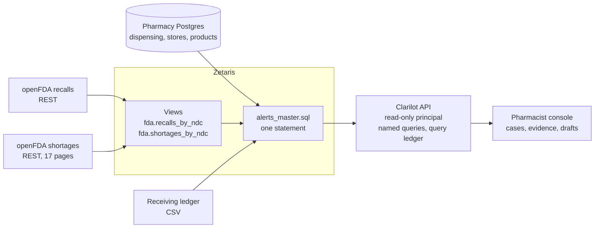

# Clarilot

**From a published FDA recall to the patients who need a call.**

An FDA recall names a drug and its lot numbers. It does not tell a pharmacy which of its patients took one home. That answer is spread across the recall feed, the pharmacy's dispensing system and its receiving records. Clarilot answers it with **one Zetaris SQL query across four sources**, without copying data into a warehouse and without an ETL job. A pharmacist then reviews each match with the evidence beside it.

[](https://youtu.be/e7oCSza6W8A)

**▶ [Watch the 3:42 demo](https://youtu.be/e7oCSza6W8A)** · [Live site](https://clarilot.vercel.app) · [Evidence](evidence) · [Builder's reflection](evidence/reflection.md)

> Every pharmacy, patient and dispensing record here is synthetic. FDA recall and shortage records are real public data from openFDA and may be delayed or incomplete. Clarilot is not a validated clinical or notification system. A flag is an investigation candidate, not a finding that a patient received a recalled lot. Clarilot never sends anything: it drafts, and a pharmacist decides.

## At a glance

| Question             | Answer                                                                                                          |
| -------------------- | --------------------------------------------------------------------------------------------------------------- |
| Who is it for        | Pharmacists working through a drug recall                                                                       |
| What it reads        | The pharmacy's Postgres database, the openFDA recall feed, the openFDA shortage feed and a receiving-ledger CSV |
| How                  | One SQL statement through Zetaris, with no ETL and no copy of the data                                          |
| What it returns      | One case per matching dispensing record, with the NDC, the lot evidence, the receipt and shortage status        |
| What it never does   | Treat a missing lot as safe, show an empty list when a source is down, or send anything                         |
| What is proven       | 10 of 10 live verification checks against Zetaris 2.4.3.1, and 125 automated tests                              |
| What is not yet fast | The four-source query takes 6 to 10 s on a laptop running Zetaris under emulation. The target was 5 s.          |

## The demo video

| Time                                       | What you see                                                                               |
| ------------------------------------------ | ------------------------------------------------------------------------------------------ |
| [0:00](https://youtu.be/e7oCSza6W8A?t=0)   | A real recall: D-0038-2027, Teva metoclopramide tablets, four lots                         |
| [0:22](https://youtu.be/e7oCSza6W8A?t=22)  | The four sources registered in Zetaris                                                     |
| [0:37](https://youtu.be/e7oCSza6W8A?t=37)  | One SQL statement across all four returns 15 cases                                         |
| [0:53](https://youtu.be/e7oCSza6W8A?t=53)  | A case where the dispensed lot appears exactly in the FDA's lot list                       |
| [1:06](https://youtu.be/e7oCSza6W8A?t=66)  | A review draft checked against the case and approved by a pharmacist; a case with no lot   |
| [1:25](https://youtu.be/e7oCSza6W8A?t=85)  | The proof behind every result: Zetaris query ID, sources and the exact SQL                 |
| [1:34](https://youtu.be/e7oCSza6W8A?t=94)  | One row inserted into Postgres; the same query now returns 16 cases                        |
| [1:49](https://youtu.be/e7oCSza6W8A?t=109) | The data-quality queue, then the pharmacy database stopped: `SOURCE_UNAVAILABLE`, not zero |
| [2:08](https://youtu.be/e7oCSza6W8A?t=128) | Cursor's agent on Grok 4.7: schema discovery over JDBC and property tests                  |
| [2:29](https://youtu.be/e7oCSza6W8A?t=149) | What was verified                                                                          |
| [2:40](https://youtu.be/e7oCSza6W8A?t=160) | Why Zetaris was amazing, in the builder's own words ([transcript](evidence/reflection.md)) |

Everything in the video was recorded from the running app and a local Zetaris instance on 2 November 2026. The narration is a synthetic voice; the reflection is the builder's own.

## How it works



1. **Four sources, one query.** [sql/named/alerts_master.sql](sql/named/alerts_master.sql) joins `pharmacy_pg.dispensing` (Postgres), `fda.recalls_by_ndc` (openFDA enforcement REST), `fda.shortages_by_ndc` (openFDA shortages REST) and `lots_files.receiving_lots` (CSV). The API runs that statement through Zetaris and never merges sources in application code.
2. **NDCs are normalised, never guessed.** 4-4, 5-3 and 5-4 product NDCs map to one 5-4 key, and the raw value is kept. Undelimited or malformed values go to the data-quality queue instead of being dropped.
3. **Lot evidence is conservative.** The classifier compares the dispensed lot with the lot tokens in the recall's `code_info`:

   | Level                       | Meaning                                                            |
   | --------------------------- | ------------------------------------------------------------------ |
   | `LOT_EXACT`                 | Lot identifier matches the recall notice                           |
   | `ALL_LOTS_EXPLICIT`         | Broad lot scope, only after a reviewed rule for that recall        |
   | `PRODUCT_MATCH_LOT_UNKNOWN` | Product matches, lot missing or unreadable; not a negative finding |
   | `LOT_DIFFERENT_UNVERIFIED`  | Product matches, lot differs; pharmacist checks the notice         |
   | `IDENTIFIER_UNVERIFIED`     | Identifier needs correction; still counted                         |
   | `SOURCE_UNAVAILABLE`        | A source failed; verification cannot complete                      |

   Missing `code_info` or a missing lot is never treated as "all lots".

4. **Every result carries its proof.** The evidence drawer shows the executed SQL, query ID, source list, fetch timestamps, latency and row count. Each run is written to the query ledger.
5. **Drafts stay drafts.** The draft text comes from a fixed template and is checked against the case facts: no invented lot, date, recall number, dosage advice or safety claim. It can only be approved or rejected as an internal state.

## Proof

| Claim                                            | Result                                                                         |
| ------------------------------------------------ | ------------------------------------------------------------------------------ |
| Four sources registered in Zetaris 2.4.3.1       | Each source's count matches a direct read of the same source                   |
| One statement reads all four                     | 15 cases, the same 15 in the SQL Editor, over JDBC and through the app         |
| A source change shows up without a sync          | One committed Postgres row added exactly one case on the next run              |
| The app cannot change Zetaris                    | The API's Zetaris user can read, and its `CREATE` is refused                   |
| A failed source is never shown as a clean result | A stopped pharmacy database shows `SOURCE_UNAVAILABLE`, not zero cases         |
| The safety rules hold for generated input        | Property tests run hundreds of generated NDCs and lots per run with no failure |
| Query time                                       | 6.0 to 8.4 s, median 7.6 s over 4 runs; the 5 s target was not met             |

All ten live checks passed on 2026-11-02. The details are in [evidence/source-parity.md](evidence/source-parity.md), the machine output in [evidence/verification.json](evidence/verification.json), and the test record in [evidence/test-results.md](evidence/test-results.md).

## Built with a coding agent

The developer ran three sessions of Cursor's agent on `grok-4.7`. Their exported transcripts are in [evidence/agent](evidence/agent), unedited.

- **Session A** connected to Zetaris over JDBC, ran `DESCRIBE` on the FDA REST tables, and found each one exposed as `meta` plus a `results` array of structs. The views already matched that shape, so it created them without changes: 624 recall rows and 1,615 shortage rows.
- **Session B** ran the four-source query unchanged and returned the same 15 cases as the app.
- **Session C** wrote fast-check property tests for NDC normalising and lot evidence (commit `f2f4705`).

Most of the rest of the code was written with Claude Code, as disclosed in the same folder.

## Builder's reflection

In the last minute of the video, the developer explains what changed: the plan had been a nightly ETL job into Postgres. Instead, one query read the pharmacy database, both FDA feeds and a CSV file, and returned fifteen cases with no pipeline. A record added to Postgres became the sixteenth on the next run. The full transcript, including what was cut for length and why, is in [evidence/reflection.md](evidence/reflection.md).

## FDA records used

Selected on 2026-11-01 from `https://api.fda.gov/drug/enforcement.json` with `_exists_:openfda.product_ndc AND report_date:[20260701 TO 20261101]` (191 matching records, `meta.last_updated` 2026-10-21). The full records, selection rules and hashes are in [seed/recalls_used.json](seed/recalls_used.json).

| Recall                                                                                            | Class | Report date | Firm                      | Product NDCs                            | Listed lots                        |
| ------------------------------------------------------------------------------------------------- | ----- | ----------- | ------------------------- | --------------------------------------- | ---------------------------------- |
| [D-0038-2027](https://api.fda.gov/drug/enforcement.json?search=recall_number%3A%22D-0038-2027%22) | II    | 2026-10-21  | Teva Pharmaceuticals USA  | 0093-2203, 0093-2204                    | 8634085, 8635085, 8636085, 8633085 |
| [D-0042-2027](https://api.fda.gov/drug/enforcement.json?search=recall_number%3A%22D-0042-2027%22) | II    | 2026-10-21  | American Health Packaging | 60687-620, 60687-631                    | 1028135, 1029555                   |
| [D-0788-2026](https://api.fda.gov/drug/enforcement.json?search=recall_number%3A%22D-0788-2026%22) | I     | 2026-08-26  | Fresenius Kabi USA        | 76045-004, -005, -006, -007, -008, -238 | 6402820                            |

Shortage context comes from all 1,615 records of `https://api.fda.gov/drug/shortages.json`, read in 17 pages of 100 (`meta.last_updated` 2026-10-30). A product absent from the pages read is `NOT_VERIFIED_IN_SUBSET`, never "available".

## Synthetic pharmacy data

Generated from a fixed seed by [seed/generate.ts](seed/generate.ts): 3 stores, 200 patients, 100 formulary products, 500 prescriptions, 1,453 dispensing rows and 39 receiving-ledger rows ([seed/receiving_lots.csv](seed/receiving_lots.csv)). Nineteen planted scenarios cover exact lots, different lots, missing lots, package NDCs, undelimited and malformed NDCs, ambiguous lot text and a future date. The expected outcome of each is in [seed/fixtures.json](seed/fixtures.json).

## Run it locally

### Requirements

- Node 24 and pnpm 10.33
- Docker (for Postgres and Zetaris)
- A Zetaris platform bundle and registry access. It is not redistributable; download it from Zetaris Cloud after signing in.

### Setup

```sh
pnpm install --frozen-lockfile
cp .env.example .env
```

In `.env`, set `PG_PASSWORD`, put the same value into `DATABASE_URL`, and set `DEMO_TOKEN` to a random string of at least 16 characters.

```sh
docker compose up -d
```

Postgres starts on `127.0.0.1:54360` and loads the schema and seed from [seed/init](seed/init).

### Register the sources in Zetaris

Run these in the Zetaris SQL Editor as an admin, one statement at a time, in order:

1. [sql/setup/01_pharmacy_datasource.sql](sql/setup/01_pharmacy_datasource.sql): the Postgres datasource. Replace `${PG_PASSWORD}` with your value in the editor only.
2. [sql/setup/02_fda_recalls.sql](sql/setup/02_fda_recalls.sql): the openFDA enforcement REST table.
3. [sql/setup/03_fda_shortages.sql](sql/setup/03_fda_shortages.sql): the openFDA shortage REST tables, 17 pages of 100.
4. Upload `seed/receiving_lots.csv` to the Zetaris file store, then run [sql/setup/04_receiving_csv.sql](sql/setup/04_receiving_csv.sql).
5. [sql/setup/05_views.sql](sql/setup/05_views.sql): the normalised views the query reads.

Then create an API key for a read-only user and add `ZETARIS_BASE_URL`, `ZETARIS_API_KEY`, `ZETARIS_ORG_ID` and `ZETARIS_PRINCIPAL` to `.env`.

### Start the app

```sh
pnpm --filter @clarilot/api dev
pnpm --filter @clarilot/web dev
```

The console is at http://localhost:5200/console and the API at http://localhost:8820/api/health.

### Insert test and reset

With `DEMO_MODE=true`, the console's demo controls (or `POST /api/demo/insert-case` with the `DEMO_TOKEN`) commit one allowlisted synthetic dispense row to Postgres: `900001`, for recall D-0038-2027 lot 8633085. Rerunning the unchanged alerts query should then return one new case. `POST /api/demo/reset` removes it. The API can only insert the allowlisted rows; every query it sends to Zetaris is a named, read-only statement.

## Verification and tests

```sh
pnpm test
pnpm typecheck && pnpm lint && pnpm format:check && pnpm build
pnpm --filter @clarilot/scripts verify
```

`pnpm test` runs 125 unit, property and API tests. `verify` compares each Zetaris source with a direct read of the same source (Postgres count, openFDA totals and timestamps, CSV line count), runs the four-source query and writes [evidence/verification.json](evidence/verification.json). Without Zetaris it records the direct side and marks every Zetaris check as failed. `--outage` also stops the pharmacy Postgres to check the outage path.

## API

| Route                                    | Purpose                                                                 |
| ---------------------------------------- | ----------------------------------------------------------------------- |
| `GET /api/health`                        | Status of Zetaris, Postgres, both openFDA feeds and the CSV             |
| `GET /api/sources`, `GET /api/freshness` | Source registration and fetch ages                                      |
| `GET /api/alerts`                        | Runs the four-source query; filters by recall, store and evidence level |
| `GET /api/alerts/:dispenseId`            | One case with its evidence                                              |
| `POST /api/alerts/:dispenseId/draft`     | Creates a template draft checked against the case                       |
| `POST /api/drafts/:draftId/decision`     | Approve or reject a draft (internal state only)                         |
| `GET /api/ledger/:queryId`               | One query ledger entry                                                  |
| `GET /api/quarantine`                    | Rows that failed the data-quality rules                                 |
| `GET /api/recalls/featured`              | The archived real recall records                                        |

## Repository

| Path                     | Contents                                                                                                        |
| ------------------------ | --------------------------------------------------------------------------------------------------------------- |
| `apps/web`               | Vite + React site: landing page and investigation console                                                       |
| `apps/api`               | Hono API, Zetaris client, ledger, drafts                                                                        |
| `packages/core`          | Wire contract, NDC normaliser, lot classifier                                                                   |
| `sql/setup`, `sql/named` | Zetaris registration SQL and the named queries the API may run                                                  |
| `seed`                   | Recall selection, synthetic data generator, Postgres init SQL, receiving CSV                                    |
| `scripts`                | Source parity checks and the Vercel packaging step                                                              |
| `evidence`               | Connection contract, source parity, query ledger, verification output, test results, agent sessions, reflection |

## Deployed site

https://clarilot.vercel.app runs the same web app and API with no pharmacy database and no Zetaris connection. The landing page and its recall cards (archived openFDA records) work. The console reports Zetaris as not configured and the pharmacy database as unavailable, and shows no cases. A local Zetaris is not reachable from Vercel, so the full flow runs locally, as shown in the video.

## Troubleshooting

- **`/api/alerts` returns `SOURCE_UNAVAILABLE`.** Zetaris is not configured or not reachable. Check the `ZETARIS_*` values and `GET /api/health`.
- **Zetaris cannot reach Postgres.** The datasource uses `host.docker.internal:54360`. If that does not resolve from the Zetaris driver container, attach the `clarilot-pg` container to the Zetaris Docker network and use its container name.
- **The API refuses to start.** `DEMO_MODE=true` requires a `DEMO_TOKEN` of at least 16 characters.
- **The four-source query suddenly takes 40 seconds or more.** The FDA tables are cached in the Zetaris engine's memory, and a restart of its driver container drops that cache, so every query reads openFDA again. On 2 November the driver had restarted and the query took 43 to 59 s. Running the `CACHE TABLE` statements from [02_fda_recalls.sql](sql/setup/02_fda_recalls.sql) and [03_fda_shortages.sql](sql/setup/03_fda_shortages.sql) again (54 s for all 18) brought it back to 6.6 to 7.6 s.
